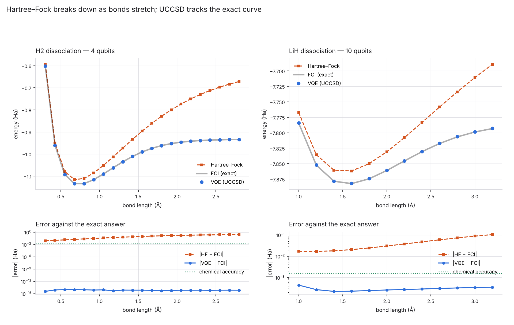
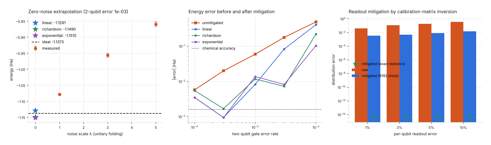

# vqelab — VQE for molecules, on my own simulator

Variational quantum eigensolver built from first principles and run on
[`../simulator`](../simulator), the state-vector engine from the first project
in this repository.

PySCF supplies the molecular integrals — computing Gaussian integrals is
solved classical chemistry and says nothing about quantum computing.
**Everything downstream of them is written here**: the second-quantised
Hamiltonian, the Jordan–Wigner mapping, the ansatz circuits, measurement
grouping, the optimiser and its gradients.

**Status: complete.**

## Validated against classical chemistry

| check | result |
|---|---|
| Hartree–Fock energy from the qubit Hamiltonian (H₂) | matches PySCF to **2 × 10⁻¹⁶ Ha** |
| Ground state of the qubit Hamiltonian (H₂) | matches PySCF FCI to **4 × 10⁻¹⁶ Ha** |
| LiH, 12 qubits, 631 Pauli terms | matches FCI to **1.5 × 10⁻¹⁴ Ha** |
| VQE with UCCSD (H₂) | **7 × 10⁻¹⁵ Ha** error, 100% of correlation energy |
| Frozen-core approximation (LiH, BeH₂, H₂O) | 0.8–3.4 × 10⁻⁴ Ha, inside chemical accuracy |

That FCI agreement is the load-bearing test: it exercises the integral
handling, the spin-orbital expansion, the operator-ordering conventions and
the fermion-to-qubit mapping simultaneously, against a completely independent
implementation of the same physics.

## The pieces

| module | what it does |
|---|---|
| `pauli.py` | Pauli operators in symplectic form — two integers per string, so multiplication is XOR plus a parity count |
| `integrals.py` | PySCF → spin orbitals, with frozen-core and active-space reduction |
| `hamiltonian.py` | Jordan–Wigner: `Z` strings that reproduce fermionic anticommutation on commuting qubits |
| `ansatz.py` | Pauli-exponential circuits, hardware-efficient layers, UCCSD |
| `estimator.py` | exact and shot-based energies, with qubit-wise commuting measurement grouping |
| `vqe.py` | the optimisation loop, parameter-shift and finite-difference gradients |
| `exact.py` | matrix-free Lanczos reference energies |

## Things worth pointing at

**Jordan–Wigner is tested, not assumed.** Electrons anticommute; qubits do
not. The `Z` strings exist to recover the minus signs, and the test suite
checks `{aᵢ, aⱼ†} = δᵢⱼ` and `{aᵢ, aⱼ} = 0` for every pair, as matrices.

**The variational principle is a test.** No trial state may ever report an
energy below the true ground state. If one does, something is broken — it
cannot be a lucky result. Checked over random parameters for both ansätze.

**Brillouin's theorem falls out.** Single excitations alone cannot improve on
Hartree–Fock, because HF orbitals are chosen precisely so their gradient
vanishes. The singles-only ansatz reproduces that.

**Measurement grouping.** Qubit-wise commuting Pauli strings share a
measurement basis: 14 → 5 settings for H₂, 275 → 75 for LiH, 550 → 178 for
H₂O. Roughly a 3× cut in the dominant practical cost.

**The parameter-shift rule is exact**, not finite differences with a good step
size — the energy's dependence on a single Pauli rotation angle is a pure
sinusoid. Verified against central differences to 4 × 10⁻¹¹.

## Running it

```bash
pip install -e ../simulator
pip install -e ".[dev,plot]"
pytest tests/ -q
```

```python
from vqelab import load_molecule, fermionic_hamiltonian
from vqelab.ansatz import UCCSDAnsatz
from vqelab.vqe import VQE

mol = load_molecule("H2")
H = fermionic_hamiltonian(mol)
result = VQE(H, UCCSDAnsatz(mol)).run(
    reference_energy=mol.fci_energy, hartree_fock_energy=mol.hf_energy
)
print(result.summary())
```

## Correctness

138 tests, 96% coverage.

## Dissociation curves



Pulling a molecule apart is the classic stress test. Near equilibrium
Hartree-Fock is already good. Stretch the bond and it collapses: a restricted
single determinant forces both electrons into the same spatial orbital, so at
large separation it describes a superposition of H–H and H⁺/H⁻ rather than
two neutral atoms. Exactly there, static correlation dominates.

| molecule | qubits | geometries | max VQE error | largest HF error |
|---|---:|---:|---:|---:|
| H₂ | 4 | 21 | **9.8e-15 Ha** | 0.2625 Ha (164× chemical accuracy) |
| LiH (frozen core) | 10 | 12 | **4.4e-04 Ha** | 0.1039 Ha (65× chemical accuracy) |

Every geometry of both molecules lands inside chemical accuracy. For H₂,
UCCSD is exact for two electrons in two orbitals, and the measured error of
10⁻¹⁵ Ha says the whole stack — integrals, mapping, circuits, optimiser — is
carrying no error of its own.

## Noise and error mitigation



Noise does not just add scatter to an energy, it **biases** it: errors drag
the state towards the maximally mixed one, which pulls the measured energy
away from the truth by far more than chemical accuracy. Averaging harder
does not fix a bias.

Zero-noise extrapolation makes the noise deliberately *worse* in a controlled
way — unitary folding, `C → C(C†C)ⁿ`, which is the identity mathematically
but multiplies the accumulated error — and extrapolates back to zero. (The
tests verify folding leaves the noiseless energy untouched; otherwise every
extrapolation would be measuring the wrong thing.)

| 2-qubit error | raw error | best mitigated | improvement |
|---:|---:|---:|---:|
| 1e-02 | 4.8e-01 Ha | **1.0e-01 Ha** (exponential) | 4.7× |
| 3e-03 | 1.8e-01 Ha | **7.2e-03 Ha** (richardson) | 24.6× |
| 1e-03 | 5.9e-02 Ha | **8.2e-03 Ha** (linear) | 7.1× |
| 3e-04 | 2.0e-02 Ha | **9.4e-04 Ha** (exponential) | 21.2× |
| 1e-04 | 5.7e-03 Ha | **3.5e-03 Ha** (linear) | 1.6× |

**The interesting part is the bottom row.** Mitigation improves things by up
to 24× in the middle of the range, and at a 3 × 10⁻⁴ two-qubit error rate it
gets inside chemical accuracy. But at 10⁻⁴ it barely helps — because
extrapolation trades **bias for variance**, and there the raw bias
(5.7 × 10⁻³ Ha) is only ~5× the statistical error of the trajectory average.
Below that ratio the fit is extrapolating noise. More trajectories would
restore the advantage; the point is that ZNE is not free, and the plot's
V shape is that trade made visible.

No single extrapolation model wins everywhere either: exponential handles
heavy noise where the energy saturates, linear is better in the shallow
regime, and Richardson overshoots at both ends. The fit's form is an
assumption, and all three are reported rather than the best one being quoted.

**Readout mitigation** is cleaner because measurement error acts only at the
end and is fully characterised by a calibration matrix. With exact
probabilities the inversion is exact (10⁻¹⁵). With 8192 shots it still
removes 12–24× of the distribution error, but not more — inverting the matrix
amplifies sampling noise, which is the honest limit.

## Correctness

169 tests, 97% coverage.

Checks worth singling out:

- **Anticommutation**, `{aᵢ, aⱼ†} = δᵢⱼ` and `{aᵢ, aⱼ} = 0`, as matrices for
  every pair — the relations that define fermions and the only reason the
  Jordan–Wigner `Z` strings exist.
- **The variational principle as a property**: no trial state may report an
  energy below the true ground state, checked over random parameters for both
  ansätze. A violation cannot be luck.
- **Brillouin's theorem** falls out: singles alone cannot improve on
  Hartree–Fock, because HF orbitals are chosen so their gradient vanishes.
- **Trajectory noise reproduces the density matrix**: for one depolarising
  channel, sampled `⟨Z⟩` matches the exact `(1 − 4p/3)²⟨Z⟩` to within the
  sampling error.
- **Folding is the identity** when noiseless, to 10⁻¹¹.
- **The parameter-shift rule is exact**, agreeing with central differences to
  4 × 10⁻¹¹.

## Limitations

- **Frozen-core and active-space reductions** are used for anything past H₂.
  They cost 0.8–3.4 × 10⁻⁴ Ha, inside chemical accuracy, but they are an
  approximation and the numbers above are against full FCI so the cost is
  visible.
- **No hardware runs.** Everything is on the simulator from `../simulator`.
- **Noise is Pauli-only.** Depolarising and readout channels are sampled
  exactly; coherent errors, crosstalk and amplitude damping are not modelled,
  and coherent errors in particular do not mitigate the same way.
- **UCCSD circuits are deep** — 64 two-qubit gates for H₂, 1376 for LiH —
  because every excitation is Trotterised term by term with no cancellation
  between them. Real implementations use circuit-level optimisation that
  would cut this substantially.

## License

MIT
